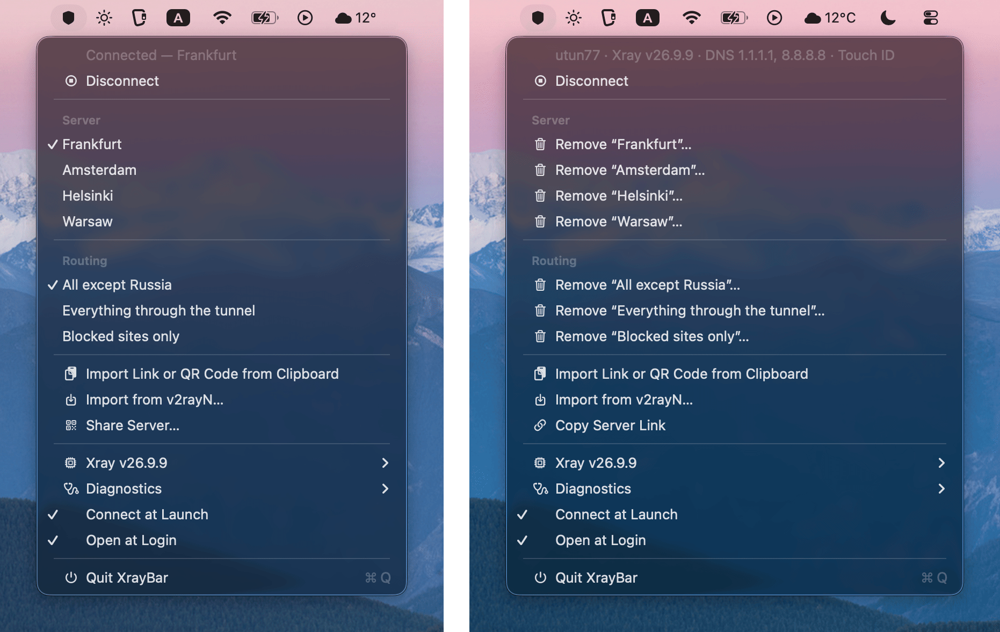

<p align="center"></p>
<h1 align="center">XrayBar</h1>
<p align="center">Небольшой нативный клиент для строки меню macOS на основе Xray-core.</p>
<p align="center">
  <a href="https://github.com/heaprip/xraybar/actions/workflows/ci.yml"></a>
  <a href="https://github.com/heaprip/xraybar/releases"></a>
  
  <a href="LICENSE"></a>
</p>
<p align="center"><a href="README.md">English</a> · <b>Русский</b></p>

XrayBar хранит ваши серверы и подключается через [Xray-core](https://github.com/XTLS/Xray-core)
и его **нативный TUN**: VLESS (REALITY, TLS) и Hysteria 2 с маршрутизацией по geosite/geoip,
весь трафик через один процесс, без посредников.

<p align="center">
  
</p>
<p align="center"><sub>Меню и то же меню с зажатым <b>Option</b> (демо-серверы).</sub></p>

> Статус: ранний; автор пользуется им каждый день. Ещё не проверено: IPv6 через туннель в
> реальной IPv6-сети, перенос DNS при смене сетевого сервиса (Wi-Fi на Ethernet).
> Не сделано: транспорты VLESS кроме raw (ws, grpc, xhttp…); обфускация gecko и realm у Hysteria 2.

## Зачем

Существующие клиенты не подошли. v2rayN работает, и этот проект многим ему обязан, но это
кроссплатформенный инструмент для многих ядер и множества настроек, и он не ощущается как
приложение для Mac. Закрытые клиенты и большинство клиентов из App Store добавляют аккаунты,
панели и экраны, на которые нужно смотреть, и не видно, что они делают от имени root.

XrayBar намеренно делает меньше. Он хранит ваши серверы, быстро подключается и в остальное
время не мешает: включите *Открывать при входе*, один раз приложите палец после входа в
систему — и всё, в обычной работе ничего нажимать не нужно. Он не создаёт и не редактирует
правила маршрутизации и, скорее всего, не будет: наборы правил берутся из v2rayN или шаблонов
runetfreedom, а XrayBar их применяет. Меню как у Wi-Fi, запрос пароля только когда нужен root,
ничего не остаётся после отключения. См. [docs/ru/PRINCIPLES.md](docs/ru/PRINCIPLES.md).

## Не доверяйте — проверяйте

XrayBar просит root и пропускает через себя весь трафик, поэтому он не должен требовать доверия
и к автору. Вместо этого он сделан так, чтобы его можно было проверить:

- **Мало и линейно.** Около 1860 строк Swift в пронумерованных файлах, которые читаются по
  порядку. Код, работающий от root, — около 270 строк shell и помощник примерно на 150 строк,
  с жёсткими ограничениями размера. Без сторонних зависимостей.
- **Root делает только то, что написано в скриптах:** [скрипт сессии](Sources/XrayBar/Resources/xraybar-session.sh)
  (TUN, DNS, запуск и остановка Xray), [скрипт установки](Sources/XrayBar/Resources/xraybar-install.sh)
  и [помощник](Sources/XrayBarHelper/main.swift). Root запускает только Xray, скопированный в
  каталог root и сверенный по SHA-256; он никогда не посылает сигналы процессам, которые не запускал.
- **Тихо.** Никакой телеметрии и аналитики. Сеть используется только по вашему запросу
  (загрузки с проверкой контрольных сумм) и для одной проверки после подключения с новой версией Xray.
- **Учётные данные** хранятся в связке ключей входа.
- [docs/ru/SECURITY.md](docs/ru/SECURITY.md): что делает приложение, модель угроз, известные
  ограничения. `scripts/audit.sh`: детерминированная опись привилегий, процессов, сети и записи
  файлов. [docs/ru/AUDIT.md](docs/ru/AUDIT.md): чек-лист проверки, пригодный как инструкция для ИИ-модели.
- **Сборки релизов** делает CI с аттестацией происхождения (см. «Установка»); или соберите сами.

Нашли проблему? Сообщите приватно на [вкладке Security](https://github.com/heaprip/xraybar/security).

## Как это сделано

XrayBar написан с помощью ИИ-агента (Claude Code) под руководством автора, который проверял
каждый шаг на настоящем Mac. Автор — опытный разработчик, для которого десктоп на платформе Apple
новая область. Все решения записаны в [docs/DECISIONS.md](docs/DECISIONS.md), а код достаточно
мал, чтобы прочитать его за один раз. Специалист по macOS его пока не проверял: ревью и issues
очень приветствуются, а [docs/ru/AUDIT.md](docs/ru/AUDIT.md) — чек-лист для самостоятельной проверки.

## Установка

Нужно: macOS 15 или новее, Apple silicon или Intel. Интерфейс следует языку системы:
английский или русский (ниже пункты меню названы как в русском).

1. Скачайте `XrayBar-x.y.z.pkg` (или `.zip`) из [последнего релиза](https://github.com/heaprip/xraybar/releases/latest).
2. Откройте его. XrayBar подписан ad hoc и не нотаризован (платного Apple Developer ID нет),
   поэтому в первый раз macOS откажет: нажмите **Готово**, затем **Системные настройки ›
   Конфиденциальность и безопасность**, найдите *«XrayBar… заблокирован»*, **Всё равно
   открыть**, подтвердите. Для `.pkg` это нужно один раз на загрузку; установленное им в
   /Applications приложение потом открывается как обычно.
3. Обновление: сначала завершите XrayBar. После обновления macOS один раз спросит, можно ли
   XrayBar пользоваться своей записью в связке ключей: **Всегда разрешать**. Если в меню
   появится *Обновить помощник (требуется)…*, выберите его.

Проверка скачанного (по желанию). Контрольные суммы лежат в релизе; аттестация доказывает, что
файл собран [workflow выпуска](.github/workflows/release.yml) этого репозитория из коммита с
тегом, а не загружен вручную:

```sh
shasum -a 256 -c SHA256SUMS
gh attestation verify XrayBar-x.y.z.pkg -R heaprip/xraybar
```

### Сборка из исходников

Хватит Command Line Tools (`xcode-select --install`), Xcode не нужен:

```sh
scripts/make-app.sh                          # собирает build/XrayBar.app (ad-hoc подпись)
cp -R build/XrayBar.app /Applications/       # и запускайте из /Applications
```

Для разработки подойдёт и `swift run` (только по-английски: переводам нужен бандл приложения).

## Первый запуск

1. **Добавьте сервер.** *Импорт ссылки или QR-кода из буфера обмена*: скопируйте ссылку
   `vless://…` или `hysteria2://…`, или нажмите ⌘⇧⌃4 и выделите QR-код (снимок попадёт в
   буфер обмена). Или *Импорт из v2rayN…* (только чтение, см. ниже).
2. **Скачайте Xray и данные маршрутизации.** *Xray › Скачать v26.10.21* и *Обновить данные
   маршрутизации* (с проверкой контрольных сумм). Установка Xray один раз спрашивает пароль: он попадает в
   каталог, принадлежащий root, — единственное место, откуда XrayBar запускает его от root.
   Если установлен v2rayN, *Скопировать Xray из v2rayN…* делает то же с его копией; данные
   маршрутизации до обновления берутся из v2rayN.
3. **Подключитесь.** macOS спросит пароль администратора: для TUN-интерфейса нужен root.
   *Подключаться по Touch ID…* один раз устанавливает небольшой помощник, принадлежащий root;
   дальше достаточно Touch ID один раз после входа в систему.
4. **Забудьте о нём.** *Подключаться при запуске* (включено по умолчанию) и *Открывать при входе*: Mac
   включился, вы приложили палец — подключено.

### Импорт из v2rayN

*Импорт из v2rayN…* читает базу v2rayN (`~/Library/Application Support/v2rayN/guiConfigs/guiNDB.db`),
открытую только на чтение: v2rayN не меняется и может работать в это время. Импорт можно
повторять; то, что уже есть в XrayBar, пропускается (сервер с тем же адресом, портом и
учётными данными; набор правил с тем же именем и правилами).

| Из v2rayN | Импортируется |
|---|---|
| Серверы VLESS (REALITY или TLS) | да; учётные данные уходят в связку ключей |
| Серверы Hysteria 2 (пароль, SNI, salamander, перебор портов, закрепление сертификата) | да; обфускацию gecko и realm XrayBar не поддерживает, такие серверы пропускаются |
| VMess, Trojan, Shadowsocks, WireGuard, … | нет |
| Наборы правил (все, например *RUv1-…* от runetfreedom) | да, правила без изменений; выбрать в *Маршрутизации* |
| Подписки, настройки DNS, активный сервер и набор, настройки Xray | нет |

*Данные* маршрутизации (`geoip.dat`, `geosite.dat`) — это не *правила*: *Обновить данные
маршрутизации* скачивает списки, а набор правил решает, что идёт напрямую, через прокси или
блокируется. Без импортированного набора в XrayBar есть только *Global* (всё через прокси,
кроме локальной сети и рекламы).

## Меню

| Пункт | Что делает |
|---|---|
| Сервер, Маршрутизация | Выбор сервера и набора правил (наборы в формате v2rayN) |
| Поделиться сервером… | Выбранный сервер в виде QR-кода |
| Xray › | Версии рядом друг с другом; первое подключение с новой версией проверяется, откат в одно нажатие. Источник и обновление данных маршрутизации. *Исключить из туннеля…* для сетей в обход Xray |
| Диагностика › | Лог, подробный лог, папка с данными, удаление помощника. Собственный лог XrayBar: Console.app, подсистема `io.github.heaprip.xraybar` |
| С **Option** | *Удалить* сервер или набор правил · *Скопировать ссылку на сервер* · технические подробности под строкой статуса · *Диагностика › Сбросить XrayBar…* |

Под root выполняется только короткий читаемый код: [скрипт сессии](Sources/XrayBar/Resources/xraybar-session.sh),
[скрипт установки](Sources/XrayBar/Resources/xraybar-install.sh) и
[помощник](Sources/XrayBarHelper/main.swift): сессия использует его наблюдение за событиями (оно
только наблюдает), а его служба для Touch ID необязательна.

## Удаление

Проще всего: отключитесь, зажмите **Option**, выберите *Диагностика › Сбросить XrayBar…* (один
пароль: удаляет серверы, настройки, данные маршрутизации, все установленные версии Xray,
помощник и запись в связке ключей, затем приложение закрывается) и удалите XrayBar из
/Applications. Вручную:

1. Отключитесь, затем *Диагностика › Удалить помощник…*, если вы его устанавливали (удаляет
   помощник, его LaunchDaemon и правило авторизации).
2. Завершите XrayBar и удалите его из /Applications (пункт «Открывать при входе» уйдёт вместе с ним).
3. Что остаётся:
   ```sh
   sudo rm -rf "/Library/Application Support/XrayBar" /var/db/xraybar  # установленный Xray, сохранённый DNS
   rm -rf ~/Library/Application\ Support/XrayBar                       # серверы, наборы правил, данные
   rm -rf ~/Library/Caches/io.github.heaprip.xraybar                   # кэш, который ведёт macOS
   sudo pkgutil --forget io.github.heaprip.xraybar                      # если ставили из .pkg
   ```
   и запись *XrayBar server credentials* в связке ключей («Связка ключей»). `/var/run/xraybar`
   очищается при перезагрузке.

## Решение проблем

- **Нет интернета после сбоя или отключения питания.** Откройте XrayBar: он предложит
  *Восстановить сетевые настройки*. Вручную: `networksetup -setdnsservers Wi-Fi empty`.
- **«Другой VPN или TUN уже направляет весь трафик».** Выключите другой VPN или режим TUN в v2rayN.
- **На иконке в строке меню точка.** Выберите *Обновить помощник (требуется)…*: приложение
  обновилось, а root-помощник ещё нет.
- **При открытии ничего не появляется.** Приложение уже запущено (только один экземпляр):
  посмотрите в строке меню или сначала завершите его.
- **Логи.** *Диагностика › Показать лог Xray*, а собственный лог XrayBar:
  `log show --last 1h --predicate 'subsystem == "io.github.heaprip.xraybar"'`. В issue укажите
  версию macOS, версию XrayBar (*О программе XrayBar*) и нужные строки лога, убрав адреса серверов.

## Тесты

```sh
scripts/test.sh                 # модульные тесты
scripts/test.sh --integration   # плюс прогон конфигов из вашего v2rayN через xray (только чтение)
```

## Обратная связь и участие

Автор пользуется XrayBar каждый день и хочет знать, как он работает у вас. Приветствуются:

- что ломается или неудобно;
- нужные протоколы и возможности (другие транспорты VLESS, настройки Hysteria 2, …), если
  XrayBar останется простым и узким;
- улучшения внешнего вида и удобства;
- issues и pull requests. Сначала прочитайте [docs/ru/PRINCIPLES.md](docs/ru/PRINCIPLES.md) и
  [docs/DECISIONS.md](docs/DECISIONS.md): изменение, которое сохраняет код маленьким и
  линейным, принять проще всего.

## Лицензия и благодарности

MIT, см. [LICENSE](LICENSE). Поведение и форматы повторяют
[v2rayN](https://github.com/2dust/v2rayN) (код v2rayN не используется). Xray-core — отдельная
программа под MPL-2.0. Данные маршрутизации:
[runetfreedom/russia-v2ray-rules-dat](https://github.com/runetfreedom/russia-v2ray-rules-dat),
[Loyalsoldier/v2ray-rules-dat](https://github.com/Loyalsoldier/v2ray-rules-dat).
